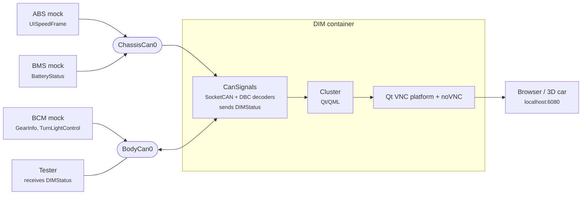

# RemotiveCar instrument cluster instance

This instance is the same topology as the [hello world instance](../hello_world/README.md), except that the `DIM`
(Driver Information Module) is a real **instrument cluster** running in a container instead of a plain RemotiveBroker.

The container replaces the DIM broker and is attached directly to the DIM CAN buses, so the cluster reads the real
CAN frames over SocketCAN, decoded with the same DBC files as every other ECU. Nothing else in the topology knows or
cares what runs inside: replace the container with any other cluster that speaks CAN and the rest of the platform is
unchanged.

The cluster is a Qt/QML application derived from the [AGL cluster demo dashboard](https://gerrit.automotivelinux.org/gerrit/admin/repos/apps/agl-cluster-demo-dashboard),
with the same look as the instrument cluster of the [3D car](../../../usecases/3D.md). It is served as a web page,
on its own or embedded in the 3D car.

> :link: [main.instance.yaml](main.instance.yaml)<br>
> :link: [dim.agl_cluster.instance.yaml](../../models/dim.agl_cluster.instance.yaml) - the DIM ECU as the cluster container<br>
> :link: [models/dim/agl_cluster](../../models/dim/agl_cluster) - the container image and the cluster application

## How the cluster is connected



The application lives in [models/dim/agl_cluster/app](../../models/dim/agl_cluster/app):

- [cansignals.cpp](../../models/dim/agl_cluster/app/cansignals.cpp) opens a raw SocketCAN socket per bus and decodes
  the frames with C code that [cantools](https://github.com/cantools/cantools) generates from
  [chassis_can.dbc](../../platform/databases/chassis_can.dbc) and [body_can.dbc](../../platform/databases/body_can.dbc)
  at image build time. The DBC files stay the single source of truth; no bit positions or scaling are written by hand.
  Every signal carries a state next to its value: the `SNA` and `Error` named values the sending ECU puts on the bus,
  or *missing* when no frame arrived within three seconds.
- [qml/](../../models/dim/agl_cluster/app/qml) is the cluster itself: speed gauge, gear strip, turn indicators,
  power/regen bar and battery state with range, and the engine lamp that turns gold while a signal reports `SNA` and
  red while one reports `Error`, exactly like the 3D car.
- [main.cpp](../../models/dim/agl_cluster/app/main.cpp) is the AGL dashboard's entry point. The agl-compositor
  integration is kept, so the same binary runs as the background of an AGL image; anywhere else it is a plain window.

The instance runs the DIM with mocks for the three ECUs that send what it displays, and nothing else. Every frame
the cluster consumes is set directly on its sender, from the dashboard, the command line or the tests, with no
behavioral model in between. The full car around the cluster, with the BCM blinking the indicators from the turn
stalk, is the Android instance with the DIM model file added, see [below](#with-the-android-example).

Signals shown today:

| Cluster element | Bus | Frame / signal |
| --- | --- | --- |
| Speed | ChassisCan0 | `UISpeedFrame.uispeed` (m/s, shown in km/h) |
| Power / regen bar | ChassisCan0 | `BatteryStatus.BatteryPower` |
| Battery, range | ChassisCan0 | `BatteryStatus.StateOfCharge` |
| Gear strip | BodyCan0 | `GearInfo.GearLeverPosition` |
| Turn indicators | BodyCan0 | `TurnLightControl.Left/RightTurnLightRequest` |

To show another signal, add a case to `cansignals.cpp` using the generated decoder and bind it in QML, then rebuild.

What the cluster displays is reported back on the bus, as a real cluster does. Every 100 ms the DIM sends
`DIMStatus` on BodyCan0 with the displayed speed in km/h (`NotDisplayed` while no valid speed is shown), the
displayed gear, both indicator lamps and the engine lamp state. Other ECUs and testers can verify the display over
CAN alone, with no side channel into the container, and a cluster that cannot be told from a real one.

The display is rendered by Qt's VNC platform plugin and served by noVNC on <http://localhost:6080>, so no display or
GPU is needed on the host. The root of that port opens the display scaled to the browser window and view only, so
the address needs no parameters, also when it is embedded in the 3D car. One quirk is handled in [Cluster.qml](../../models/dim/agl_cluster/app/qml/Cluster.qml):
Qt's VNC server sends its native BGRX pixels whatever the client asks for, while noVNC reads RGBX, so on the VNC
platform the theme colours are painted with red and blue swapped.

## Host setup

- Linux with [RemotiveBus](https://docs.remotivelabs.com/docs/remotive-bus/install). The cluster reads the CAN buses
  directly over SocketCAN.
- No display is needed on the host. The cluster is rendered in the container and viewed in a browser.

## Getting started

From the root of this repository:

### Build

```bash
remotive topology build -f remotive_car/instances/agl_cluster/main.instance.yaml remotive_car/build
```

### Run

```bash
docker compose -f remotive_car/build/remotive_car_agl_cluster/docker-compose.yml --profile 3dcar up --build
```

The cluster is available at <http://localhost:6080>.

### Cluster in the 3D car

The [3D car](../../../usecases/3D.md) can embed a web page as the instrument cluster, the same way it embeds the
Android screen. It takes the page from the `clusterIframe` query parameter, so open the 3D car with the cluster
page baked into the link:

**[Open the 3D car with the cluster](http://localhost:3000/?clusterIframe=http://localhost:6080)**

```
http://localhost:3000/?clusterIframe=http://localhost:6080
```

The 3D car remembers the setting in the URL. It can also be changed in the *Instrument Cluster* panel of the 3D car
UI, together with zoom and offset.

### Drive the cluster from the dashboard

The easiest way to interact with the cluster is the [RemotiveStudio](https://docs.remotivelabs.com/docs/remotive-studio)
dashboard [cluster.dashboard.json](cluster.dashboard.json). Start Studio from the root of this repository and open
the dashboard:

```sh
remotive studio
```

It shows the cluster page next to a restbus panel that sets what the cluster receives, with charts of what the
cluster reports back in `DIMStatus` on BodyCan0, so every stimulus can be checked against the display and against
the bus:

- **Speed**: `UISpeedFrame.uispeed` on ChassisCan0, in m/s. 20 shows as 72 km/h and comes back as
  `DIMStatus.DisplayedSpeed`.
- **Turn lights**: `TurnLightControl.LeftTurnLightRequest` and `RightTurnLightRequest` on BodyCan0, 1 lights the
  lamp, which comes back as `DIMStatus.LeftIndicatorLamp` and `RightIndicatorLamp`.
- **Gear**: `GearInfo.GearLeverPosition` on BodyCan0, 0 Reverse, 1 Drive, traced together with `DIMStatus`.

The restbus panel controls the running instance of the workspace Studio was started in, so build and run the
topology from the same directory as `remotive studio`.

### From the command line

The same signals can be set with the RemotiveCli, for example the speed and the left indicator:

```sh
remotive broker restbus update --signal ABS-ChassisCan0:UISpeedFrame.uispeed:20
remotive broker restbus update --signal BCM-BodyCan0:TurnLightControl.LeftTurnLightRequest:1
```

`candump` inside the container shows the frames as the cluster reads them:

```bash
docker compose -f remotive_car/build/remotive_car_agl_cluster/docker-compose.yml exec dim candump chassiscan0
```

### With the Android example

The DIM model file can be added to any instance. Together with the [Android instance](../android/README.md) the
cluster is fed by the car's own ECU models instead of the mocks: it shows the recorded drive while Android follows
the same drive on the map, and the BCM blinks the indicators from the turn stalk.

```bash
remotive topology build \
-f remotive_car/instances/android/main.instance.yaml \
-f remotive_car/instances/android/cuttlefish.instance.yaml \
-f remotive_car/models/dim.agl_cluster.instance.yaml \
remotive_car/build

docker compose -f remotive_car/build/remotive_car_android/docker-compose.yml \
-f remotive_car/instances/android/cuttlefish.compose.yaml \
--profile playback --profile 3dcar up --build
```

Then **[open the 3D car with the cluster](http://localhost:3000/?clusterIframe=http://localhost:6080)** to see Android on the main display and the cluster on the
instrument cluster, both driven by the recording. Android is reachable on its own at <https://localhost:8443> and the
cluster at <http://localhost:6080>.

### Tests

[tests/pytest/cluster](../../tests/pytest/cluster) checks the cluster over CAN alone: it drives the frames the DIM
consumes on the ABS and BCM mocks and waits for the matching `DIMStatus` on BodyCan0. Displayed speed, gear, the
indicator lamps following a blinking request and the blanked speed when `UISpeedFrame` stops are covered. Build the
instance with the tester added and run the `tester` profile, from the root of this repository:

```bash
remotive topology build \
-f remotive_car/instances/agl_cluster/main.instance.yaml \
-f remotive_car/tests/pytest/cluster/cluster.instance.yaml \
remotive_car/build

docker compose -f remotive_car/build/remotive_car_agl_cluster/docker-compose.yml --profile tester up --build --abort-on-container-exit
```

The [dashboard](#drive-the-cluster-from-the-dashboard) makes the same checks by hand.

The tests are marked `cluster` and excluded from the default test run, which expects the restbus DIM. Nothing in
them is specific to the container: pointed at a broker on physical CAN with a real cluster attached, they test that
cluster the same way.

The default test suites in [tests](../../tests) depend on the `DIM-broker.com` service, which this instance replaces
with the cluster container, so they are not included here.
